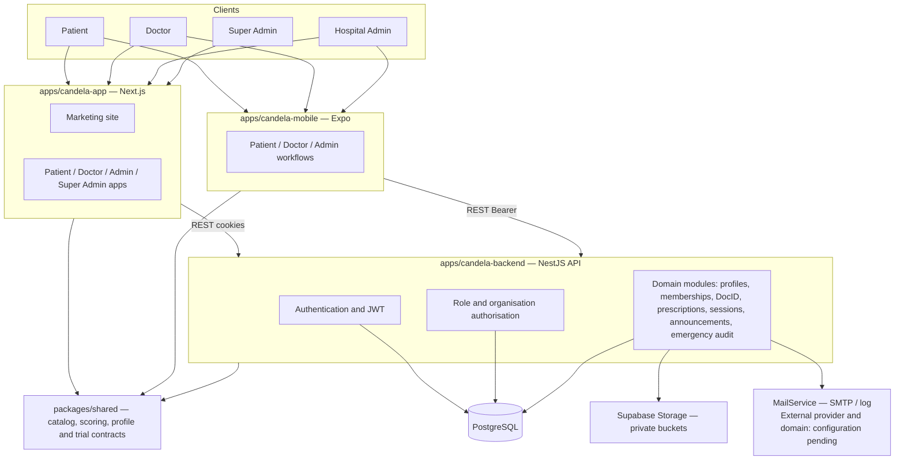
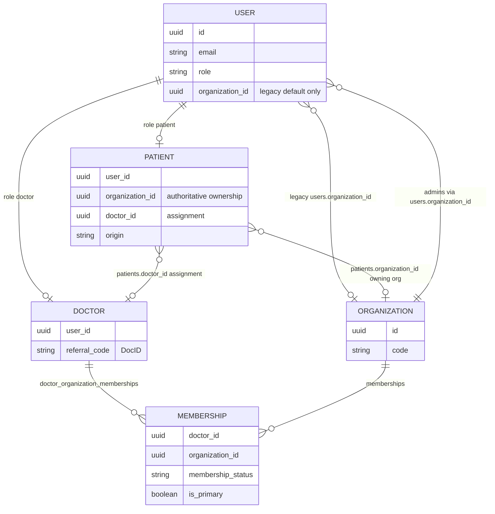
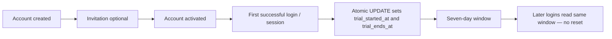
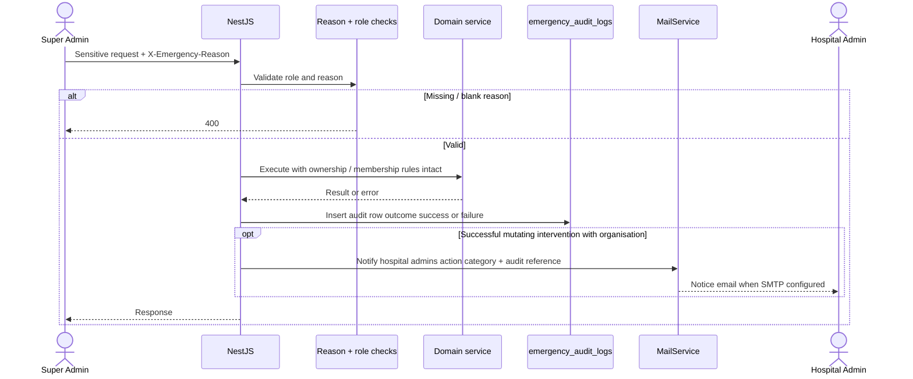

# Candela Platform Architecture

Canonical technical architecture for the Candela monorepo. Authentication and role flows: [AUTH_AND_ROLES_FLOW.md](./AUTH_AND_ROLES_FLOW.md). Environment and external setup: [DEPLOYMENT_AND_ENV.md](./DEPLOYMENT_AND_ENV.md). Chronological decisions: [CANDELA_ARCHITECTURE_CHANGE_LOG.md](./CANDELA_ARCHITECTURE_CHANGE_LOG.md). Docs index: [README.md](./README.md).

This document reflects the **implemented** application (entities, controllers, migrations, clients). External email provider/domain configuration and several live integrations remain **pending** — see [DEPLOYMENT_AND_ENV.md](./DEPLOYMENT_AND_ENV.md).

---

## 1. System overview

Candela is a precision visual and cognitive therapy platform. Interactive exercises run on Web and Mobile (Expo). A single NestJS backend is authoritative for identity, access control, clinical ownership, sessions, invitations, and audit.

### Diagram 1 — Candela system architecture



**Boundaries**

| Layer | Responsibility |
|---|---|
| `packages/shared` | Game catalog, levels, scoring formulas, session types, profile/trial types, shared contracts |
| `apps/candela-backend` | Authoritative auth, ownership, memberships, prescriptions, sessions, profiles, trials, invitations, emergency audit |
| `apps/candela-app` | Next.js marketing + role applications |
| `apps/candela-mobile` | Expo equivalent supported workflows |
| `apps/candela-tv` | Future TV client (not in current wave scope) |

---

## 2. Monorepo layout

```
Candela/
├── apps/
│   ├── candela-app/          Next.js App Router (web)
│   ├── candela-backend/      NestJS API (shared by web / mobile / TV)
│   ├── candela-mobile/       Expo / React Native
│   └── candela-tv/           TV (platform TBD)
├── packages/
│   └── shared/               Pure TypeScript shared across clients and backend
└── docs/                     Architecture and operational guides
```

Notable backend modules: `auth`, `profiles`, `memberships`, `docid`, `prescriptions`, `game-sessions`, `announcements`, `super-admin`, `audit`, `mail`, `familiar-faces`, `entities`, `migrations`.

---

## 3. Technology stack

| Layer | Technology |
|---|---|
| Web | Next.js (App Router), TypeScript, Tailwind CSS |
| Mobile | React Native + Expo |
| Backend | NestJS, TypeORM, JWT, bcrypt |
| Database | PostgreSQL (hosted on Supabase) |
| Object storage | Supabase Storage (private buckets) |
| Monorepo | npm workspaces |

---

## 4. Role model

| Role | Code value | Responsibility |
|---|---|---|
| **Super Admin** | `super_admin` | Platform health, create organisations, platform metrics/announcements. Emergency intervention with reason + audit. Does **not** perform routine hospital administration. |
| **Hospital Admin** | `admin` | Own organisation only: doctors, memberships, org profile, internal reassignment requests, org-scoped patients. |
| **Doctor** | `doctor` | Treat assigned patients, prescribe, analytics. May belong to multiple organisations. One account, one DocID (`doctors.referral_code`). |
| **Patient** | `patient` | Play permitted exercises, view own progress. May be doctor-assigned and/or org-owned. |
| **Self-user** | patient with `origin = self_signup` | Independent signup. May have **no doctor** and **no organisation**. `patients.organization_id = NULL` is **valid**, not corrupted. |

---

## 5. Identity and relationship model

### Diagram 2 — User and organisation relationships



### Three distinct patient/doctor concepts

| Concept | Field | Meaning |
|---|---|---|
| Owning organisation | `patients.organization_id` | Authoritative organisation that owns the patient record |
| Assigned doctor | `patients.doctor_id` | Currently treating doctor |
| Doctor memberships | `doctor_organization_memberships` | Which organisations the doctor may work in |

They are separate because a doctor may belong to several organisations while a patient has **one** owning organisation at a time. Changing a doctor's primary membership **must never** silently change patient ownership.

### Doctor access to a patient (fail closed)

All of the following must hold:

1. `patients.doctor_id` equals the acting doctor.
2. `patients.organization_id` is non-null.
3. The doctor has an **active** membership in that owning organisation.

There is **no** primary-organisation fallback.

### Organisation membership

- Statuses: `active` | `suspended` | `ended` (historical rows retained).
- At most one logical active membership per doctor–organisation pair (enforced in service logic / uniqueness).
- `is_primary` marks the doctor's default organisation for legacy reference sync.
- Doctor organisation invitations (`doctor_organization_invitations`) activate membership only after the **authenticated invitee** accepts.

**Authoritative access:** `doctor_organization_memberships`.

**Legacy field:** `users.organization_id` is a default/announcement reference only. It is synchronised to the active primary membership (or cleared when none exists). It is **not** an authorisation source for doctor–patient access.

---

## 6. Identity profiles and completion

Shared completion rules live in `packages/shared` (`profile-completion.ts`). Clients must not invent required fields.

### Patient (`patients` + `users`)

| Field | Owner | Required for completion | Notes |
|---|---|---|---|
| name | `users` | Yes | |
| email | `users` | — | Account identity; not toggled by complete |
| phone | `users` | Yes | |
| date_of_birth | `patients` | Yes | ISO date; not future |
| gender | `patients` | No | Optional |
| preferred_language | `patients` | Yes | |
| city / state | `patients` | Yes | |
| country | `patients` | Yes | ISO 3166-1 alpha-2 (length 2) |
| profile_photo_path | `patients` | No | Upload via API; signed URL in responses |
| guardian_* | `patients` | Yes if age &lt; 18 | Name, phone, relationship |
| identity_profile_completed_at | `patients` | — | Null = incomplete |
| account_activated_at | `patients` | — | Activation (not profile) |
| trial_started_at / trial_ends_at | `patients` | — | Trial (not profile) |

### Doctor (`doctors` + `users`)

| Field | Owner | Required for completion | Notes |
|---|---|---|---|
| name / phone | `users` | Yes | |
| email | `users` | — | |
| referral_code | `doctors` | — | **DocID** — system identifier; not editable via profile |
| professional_title | `doctors` | Yes | |
| specialization | `doctors` | Yes | |
| qualifications | `doctors` | Yes | Non-empty JSON string array |
| preferred_language | `doctors` | Yes | |
| years_experience | `doctors` | No | Optional |
| external_registration_id | `doctors` | No | External professional ID — **not** DocID |
| profile_photo_path | `doctors` | No | |
| identity_profile_completed_at | `doctors` | — | |

### Organisation (`organizations`)

| Field | Required for completion | Notes |
|---|---|---|
| name | Yes | |
| code | — | Unique org code at create |
| contact_email | Yes | |
| organization_type | Yes | Free string |
| contact_phone | Yes | |
| address_line1 | Yes | |
| address_line2 | No | |
| city / state | Yes | |
| country | Yes | Length 2 |
| website | No | |
| license_number | No | |
| logo_path | No | Upload via API |
| identity_profile_completed_at | — | |

### Completion behaviour

- `identity_profile_completed_at` null ⇒ incomplete.
- Partial `PATCH` is allowed; explicit `POST …/profile/complete` validates required fields.
- Soft onboarding: dismissible banner (~24h local dismiss via `PROFILE_PROMPT_DISMISS_MS`). **Does not block gameplay.**
- Independent of account activation, trial, and any future subscription.

---

## 7. Trial lifecycle

**Rule:** Eligible patients receive one seven-day free trial starting at the **first successful authenticated session** (login / session build), not first gameplay.

### Diagram 6 — Trial lifecycle



- Columns: `patients.trial_started_at`, `patients.trial_ends_at`.
- Implementation: conditional `UPDATE … WHERE trial_started_at IS NULL … RETURNING …` in `AuthService.ensurePatientTrialStarted`.
- Server clock is authoritative.
- Not started by invitation delivery, profile completion, or game-session creation alone.
- No payment-provider integration in this wave.

---

## 8. Patient transfer workflows

DocID requests live in `docid_requests` with hashed confirm tokens and history in `patient_docid_history`.

### Diagram 5 — Patient transfer workflows

```mermaid
flowchart TB
  subgraph PatientInitiated
    PI1[Patient enters DocID]
    PI2{Same owning org?}
    PI3[Optional explicit organizationId for cross-org]
    PI4[Receiving doctor must be active in target org]
    PI5[Receiving doctor accepts]
    PI6[Transactional ownership and assignment update]
    PI1 --> PI2
    PI2 -->|yes| PI4
    PI2 -->|no / first link| PI3 --> PI4
    PI4 --> PI5 --> PI6
  end

  subgraph HospitalAdmin
    HA1[Admin selects patient and target DocID]
    HA2[Same patients.organization_id only]
    HA3[Both doctors active in admin org]
    HA4[Patient confirms via email link]
    HA5[Assignment updated — ownership unchanged]
    HA1 --> HA2 --> HA3 --> HA4 --> HA5
  end

  subgraph SuperAdmin
    SA1[SA selects patient, DocID, target organizationId]
    SA2[Destination doctor active in target org]
    SA3[X-Emergency-Reason + audit]
    SA4[Patient confirms via email link]
    SA5[Ownership and assignment updated]
    SA1 --> SA2 --> SA3 --> SA4 --> SA5
  end
```



| Workflow | Initiator | Acceptor (implemented) | Ownership change |
|---|---|---|---|
| Patient attach / change (`self` / `change`) | Patient | **Receiving doctor** | May set or change org when explicit `organizationId` provided |
| Hospital Admin internal (`internal`) | Hospital Admin | **Patient** (email confirm) | Unchanged (`patients.organization_id` preserved) |
| Super Admin cross-org (`internal` + target org) | Super Admin | **Patient** (email confirm) | Moves to target organisation |

Do not merge these into one generic process.

---

## 9. Super Admin emergency access

Sensitive Super Admin operations require header `X-Emergency-Reason` (server-validated, non-empty). Ordinary platform operations (list/create organisations, metrics, announcements) do not.

### Diagram 7 — Emergency intervention



Table `emergency_audit_logs` (migration `AddEmergencyAuditLogs1800000000000`): actor, role, organisation, resource, action, reason, outcome, correlation id, optional before/after JSON, timestamp.

**Guarantees:** Application APIs do not expose update/delete for audit rows (insert-only). This is **not** a database-level immutability guarantee (no DB role lockdown documented).

Ownership, membership, and DocID transfer integrity rules are **not** bypassed by emergency access.

---

## 10. Email and storage (implementation vs configuration)

| Concern | Application code | External setup |
|---|---|---|
| Invitation / DocID / reset / emergency notify | `MailService` (SMTP or `log`) | Production domain + provider **not configured / not verified** as a product fact |
| Profile photos / logos | Upload + signed URLs | Private `profile-photos` bucket + Supabase secrets |
| Familiar Faces | Separate bucket | `familiar-faces` |

**Email delivery status: Implemented in application logic; external provider/domain configuration and live delivery testing pending.**

With `MAIL_TRANSPORT=log`, sends are skipped (return `false`); some callers also print redacted links for local debugging.

---

## 11. Design principles

1. Shared package is the contract for games and identity completion helpers.
2. Backend is authoritative for security and clinical ownership.
3. Dual auth: httpOnly cookies (web) and Bearer (mobile).
4. Fail-closed organisation and patient access.
5. Finished plays only enter `game_sessions` analytics — see [SESSION_METRICS_AND_ANALYTICS.md](./SESSION_METRICS_AND_ANALYTICS.md).

---

## 12. Related documents

| Doc | Focus |
|---|---|
| [AUTH_AND_ROLES_FLOW.md](./AUTH_AND_ROLES_FLOW.md) | Login, invitations, Option C, sessions, scoping |
| [DEPLOYMENT_AND_ENV.md](./DEPLOYMENT_AND_ENV.md) | Env vars, migrations, pending external QA |
| [DOCID_AND_MAIL.md](./DOCID_AND_MAIL.md) | DocID request mail details |
| [CANDELA_ARCHITECTURE_CHANGE_LOG.md](./CANDELA_ARCHITECTURE_CHANGE_LOG.md) | Entries 002–004 (implementation), 005 (docs consolidation) |
