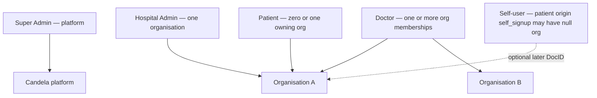
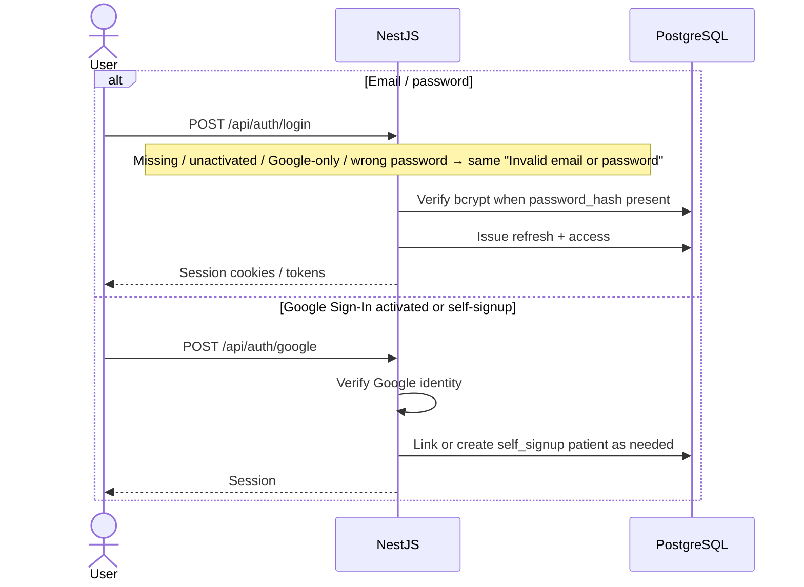
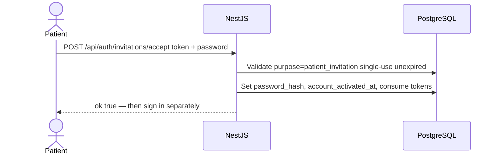
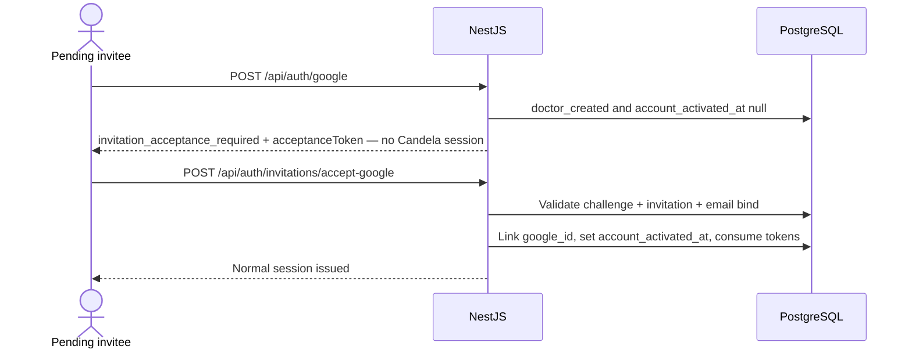
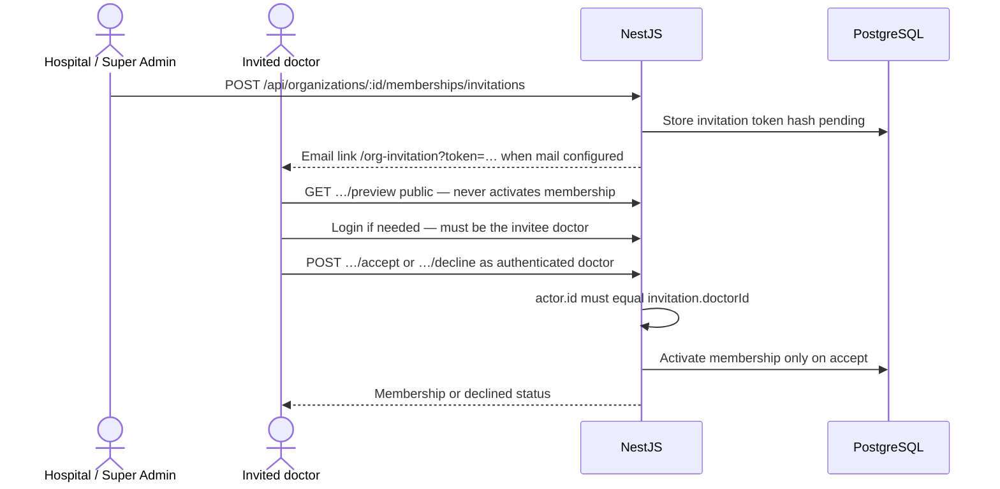

# Authentication, Roles & Access Flows

Canonical authentication and authorisation reference. System architecture: [ARCHITECTURE.md](./ARCHITECTURE.md). Environment: [DEPLOYMENT_AND_ENV.md](./DEPLOYMENT_AND_ENV.md). Change history: [CANDELA_ARCHITECTURE_CHANGE_LOG.md](./CANDELA_ARCHITECTURE_CHANGE_LOG.md).

---

## 1. Role hierarchy and access matrix

### Diagram 4 — Role and access-control boundaries



| Role | Landing (web) | Capabilities |
|---|---|---|
| Visitor | `/` | Marketing, login, signup, forgot/reset password, invitation pages |
| Patient (self-signup) | `/dashboard` | All catalog modules until linked; soft profile prompt; may have null org |
| Patient (doctor-created / linked) | `/dashboard` | Prescribed modules; soft profile prompt |
| Doctor | `/doctor` | Patients in active org scopes, prescribe, analytics, profile, org invitations |
| Hospital Admin | `/admin` | Doctors, org profile, internal transfers, org patients |
| Super Admin | `/super-admin` | Organisations, metrics, announcements; sensitive ops need emergency reason |

Mobile mirrors supported workflows (`login`, `dashboard`, `doctor`, `admin`, `super-admin`, profile screens, invitation screens).

---

## 2. Session model

| Token | Lifetime | Transport |
|---|---|---|
| Access JWT | ~1 day | Web: `httpOnly` cookie `candela_access`. Mobile: `Authorization: Bearer` |
| Refresh (opaque SHA-256) | ~14 days | Cookie / stored token; rotated on use |

Production cross-site cookies: `sameSite=none`, `secure=true`, credentials included, CORS origin not `*`.

Session payload includes role-specific doctor/patient data. For patients, first successful session build may start the trial (`ensurePatientTrialStarted`).

---

## 3. Normal authentication

### Diagram 3a — Password and Google login (activated accounts)



**L4:** Password login does not reveal whether an email exists or is activated. Forgot-password always returns `{ ok: true }`.

---

## 4. Patient invitation lifecycle

Doctor-created patients: `password_hash = null`, `origin = doctor_created`, `account_activated_at = null` until acceptance.

### Diagram 8 — Patient creation and email delivery

```mermaid
sequenceDiagram
  actor Doc as Doctor
  participant API as NestJS
  participant DB as PostgreSQL
  participant Mail as MailService

  Doc->>API: POST /api/doctors/me/patients + X-Organization-Id
  API->>API: Assert active membership in that org
  API->>DB: BEGIN
  API->>DB: Insert user password_hash null
  API->>DB: Insert patient ownership doctor_id + organization_id
  API->>DB: Insert patient_invitation token hash only
  API->>DB: COMMIT
  API->>Mail: Send activation link after commit
  alt SMTP success
    Mail-->>API: emailSent true
  else log mode or SMTP failure
    Mail-->>API: emailSent false — account and invite remain; authorised resend OK
  end
  API-->>Doc: Patient summary + emailSent + expiresAt — no raw token
```

### Password acceptance (Method A)



Activation source of truth: **`patients.account_activated_at`**. Not `password_hash`. Not profile completion.

### Diagram 3b — Google Option C



Pending invitees **cannot** obtain a normal session via Google alone. Challenge TTL defaults to 15 minutes (`GOOGLE_INVITATION_ACCEPT_TTL_MINUTES`).

---

## 5. Doctor organisation invitation

### Diagram 3c — Authenticated org invitation acceptance



- Token alone does not activate membership.
- Another doctor cannot accept.
- One doctor account and one DocID across organisations.
- Web: `/org-invitation`. Mobile: `org-invitation` (+ scheme `candela`).

---

## 6. Password reset and token purpose isolation

| Purpose | Table / rows | Used by |
|---|---|---|
| `password_reset` | `password_reset_tokens` | Forgot / reset password |
| `patient_invitation` | same table, different purpose | Patient activation |
| Doctor org invite | `doctor_organization_invitations` | Separate entity |

Password-reset cannot activate an unactivated invitee. Invitation accept rejects `password_reset` tokens. Resend patient invitation invalidates outstanding **patient_invitation** tokens only.

---

## 7. Organisation scoping

| Actor | Scope |
|---|---|
| Doctor | `X-Organization-Id` must match an **active** membership for writes such as patient create |
| Hospital Admin | `users.organization_id` for admin org boundary; patients filtered by `patients.organization_id` |
| Super Admin | Platform-wide for listed platform routes; sensitive routes need `X-Emergency-Reason` |

Doctor–patient clinical access uses membership in **`patients.organization_id`**, never doctor primary alone.

---

## 8. Transfer authorisation summary

See [ARCHITECTURE.md](./ARCHITECTURE.md) §8 for diagrams.

| Flow | Who starts | Who confirms (code) | Cross-org |
|---|---|---|---|
| Patient DocID request | Patient | Receiving doctor | Yes if explicit `organizationId` and membership valid |
| Admin transfer | Hospital Admin | Patient email confirm | No — same owning org |
| SA cross-org transfer | Super Admin | Patient email confirm | Yes — requires emergency reason + audit |

---

## 9. Emergency access

Sensitive Super Admin routes require `X-Emergency-Reason`. Audit inserts into `emergency_audit_logs`. Successful mutating interventions may email hospital admins (action category + audit id; no clinical session payloads). Ordinary platform ops do not require a reason.

Details and diagram: [ARCHITECTURE.md](./ARCHITECTURE.md) §9.

---

## 10. Trial vs activation vs profile

| Concept | Field / trigger |
|---|---|
| Account activation | `account_activated_at` — invitation accept |
| Identity profile complete | `identity_profile_completed_at` — explicit complete |
| Trial | `trial_started_at` / `trial_ends_at` — first successful session |
| Subscription | Not implemented |

---

## 11. Related APIs (selected)

| Method | Path | Notes |
|---|---|---|
| POST | `/api/auth/login` | Opaque failures |
| POST | `/api/auth/google` | May return Option C challenge |
| POST | `/api/auth/invitations/accept` | Password activate |
| POST | `/api/auth/invitations/accept-google` | Google activate + session |
| GET/POST | `/api/doctor-organization-invitations/:token/*` | Preview public; accept/decline doctor-auth |
| GET/PATCH/POST | `/api/me/profile*` | Identity profile |
| POST | `/api/docid/requests` | Patient DocID |
| POST | `/api/docid/transfers` | Hospital Admin internal |
| POST | `/api/docid/cross-organization-transfers` | Super Admin + emergency reason |

DocID mail details: [DOCID_AND_MAIL.md](./DOCID_AND_MAIL.md).
