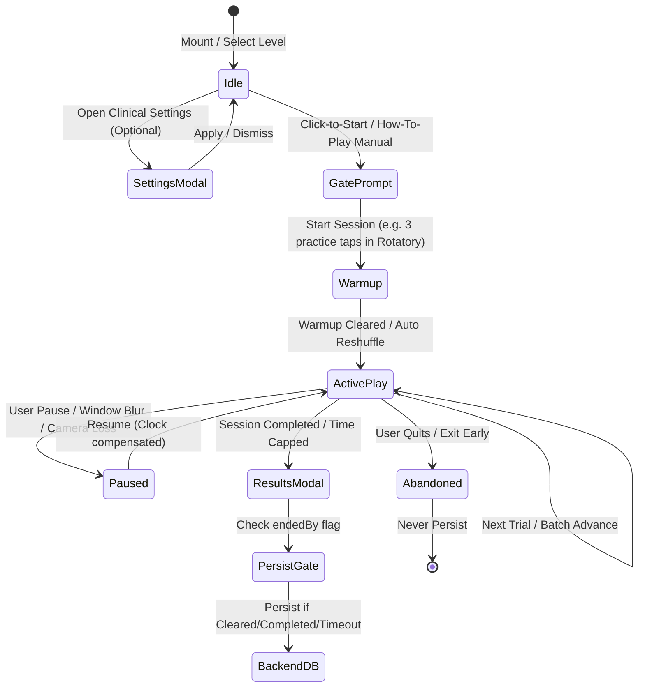

# Candela Vision Therapy Platform — Complete Game Ecosystem & Technical Specification

> **Purpose:** This document is an exhaustive, technical reference containing the exact rules, mechanics, mathematical models, clinical parameters, error taxonomy, state machines, and data contracts for all games in the Candela Vision Therapy platform. It is designed to be fed into LLMs (like GPT) for architectural planning, engine abstraction (Game Core / Device Config / Renderer split), and multi-platform expansion (Web, Mobile Expo, TV).

---

## Table of Contents
1. [Monorepo Architecture & Decoupling Strategy](#1-monorepo-architecture--decoupling-strategy)
2. [Universal Session Lifecycle & Clock System](#2-universal-session-lifecycle--clock-system)
3. [Standardized Error Taxonomy & Mathematics Engine](#3-standardized-error-taxonomy--mathematics-engine)
4. [Audio, Haptics & Sensory Feedback Architecture](#4-audio-haptics--sensory-feedback-architecture)
5. [Universal Clinical Settings & Customization Engine](#5-universal-clinical-settings--customization-engine)
6. [Data Persistence, Idempotency & Backend Schema](#6-data-persistence-idempotency--backend-schema)
7. [Comprehensive Deep-Dive: All 14 Therapy Modules](#7-comprehensive-deep-dive-all-14-therapy-modules)
   - [Spin Field Family](#71-spin-field-family)
     - [1. Rotatory Wheel (`rotatory`)](#1-rotatory-wheel-rotatory)
     - [2. Sorting Module (`sorting`)](#2-sorting-module-sorting)
   - [Tap Timing Family](#72-tap-timing-family)
     - [3. Mobile Target Bubble Chase (`mobile_target`)](#3-mobile-target-bubble-chase-mobile_target)
     - [4. Pursuit Module (`pursuit`)](#4-pursuit-module-pursuit)
     - [5. Gaze Hold / Look Pursuit (`computer_vision`)](#5-gaze-hold--look-pursuit-computer_vision)
   - [Look Jumps Family](#73-look-jumps-family)
     - [6. Crowded Search (`number_search`)](#6-crowded-search-number_search)
     - [7. Hex-Hive Peripheral View (`peripheral_view`)](#7-hex-hive-peripheral-view-peripheral_view)
   - [Glimpse Hold Family](#74-glimpse-hold-family)
     - [8. Hold the Code (`pattern_match`)](#8-hold-the-code-pattern_match)
     - [9. Location Memory & Match Pairs (`location_memory`)](#9-location-memory--match-pairs-location_memory)
     - [10. Direction Sense (`direction_sense`)](#10-direction-sense-direction_sense)
     - [11. Familiar Faces (`familiar_faces`)](#11-familiar-faces-familiar_faces)
   - [Trace & Build Family](#75-trace--build-family)
     - [12. Bee Path Tracing (`bee_tracing`)](#12-bee-path-tracing-bee_tracing)
     - [13. Geoboard: Draw a Pattern (`geoboard`)](#13-geoboard-draw-a-pattern-geoboard)
   - [Pediatric Sensory Module](#76-pediatric-sensory-module)
     - [14. Pediatric Wind Chime (`wind_chime`)](#14-pediatric-wind-chime-wind_chime)
8. [Cross-Platform Input & Hardware Considerations](#8-cross-platform-input--hardware-considerations)

---

## 1. Monorepo Architecture & Decoupling Strategy

The repository follows an **npm workspaces** monorepo structure:
```
Candela/
├── apps/
│   ├── candela-app/      # Next.js (App Router), React, CSS Modules (Website & Web App)
│   ├── candela-backend/  # NestJS, TypeORM, PostgreSQL (Unified API for Web, Mobile, TV)
│   ├── candela-mobile/   # React Native Expo (iOS / Android) [Target stack]
│   └── candela-tv/       # Smart TV App (Android TV / Tizen / WebOS) [Target stack]
└── packages/
    └── shared/           # Pure TypeScript logic, models, math, audio synthesis, types
```

### The Planned Architectural Split (Target Design)
To support seamless portability across Web (DOM/Canvas/SVG), Mobile (React Native Skia/GestureHandler), and TV (Focus/D-Pad navigation), all modules are structured to decompose into 4 discrete layers:
1. **Game Core (Pure Logic / State Machine):**
   - Independent of React, DOM, Canvas, or browser APIs.
   - Deterministic tick or event-driven state transitions (`setup`, `warmup`, `active`, `paused`, `trial_ended`, `session_ended`).
   - Trial queues, procedural generators, collision math, error classification.
2. **Device Config Layer:**
   - Viewport scaling, safe areas, aspect ratios, DPI adjustments.
   - Device tier resolution:
     - `mobile`: width < 600px OR landscape mobile (width < 1024px & height < 500px).
     - `tablet`: 600px ≤ width ≤ 1200px.
     - `tv` (or Desktop): width > 1200px.
   - Input capabilities (multitouch, mouse, stylus pressure, camera gaze, TV remote/gamepad).
3. **Renderer / Presentation Layer:**
   - Web: CSS Modules, HTML5 `<canvas>`, SVG paths, WebGL / WebEyeTrack.
   - Mobile: React Native Skia, react-native-reanimated.
   - TV: Directional focus manager, large spatial anchors.
4. **Session Bus & Telemetry Pipeline:**
   - Gated session metrics collector.
   - Pause-drift clock adjustment.
   - CSV export & NestJS backend persistence adapter.

---

## 2. Universal Session Lifecycle & Clock System

### Session State Transitions
Every Candela activity executes through a standardized lifecycle:


### Clock Drift & Pause Compensation (`use-pause-shifted-clock`)
Visual latency, reaction time, and trial durations must **never** be penalized when a patient pauses or when an eye-tracking session temporarily drops the face.
- **Mechanism:** When a pause event begins (`pausedAt = performance.now()`), the system tracks accumulated pause duration:
  $$\Delta t_{\text{pause}} = \sum (t_{\text{resume}} - t_{\text{pause}})$$
- **Corrected Elapsed Time:**
  $$t_{\text{effective}} = t_{\text{now}} - t_{\text{start}} - \Delta t_{\text{pause}}$$
- If a trial is interrupted during an active target onset (e.g., in Rotatory Wheel), the trial records the raw taps but flags `validForRt = false` so that reaction-time statistics (median/mean) are not corrupted by the interruption.

---

## 3. Standardized Error Taxonomy & Mathematics Engine

### The 4-Way Universal Error Taxonomy
To prevent ambiguous metric reporting, every single user action across all games maps into one of **four mutually exclusive outcomes**:
1. **`correct`:** Patient successfully tapped or dwelled on the designated target.
2. **`wrongTaps` (Discrimination Error):** Patient selected an active distractor stimulus, wrong letter/number, or wrong sequence order.
3. **`misses` (Motor / Aim Error):** Patient clicked empty play space, the spinning wheel rim, blank background, or outside the active target corridor.
4. **`timeouts`:** The target duration expired before a hit occurred.

*Note for legacy backward-compatibility:*
$$\text{wrong} = \text{wrongTaps} + \text{misses} + \text{timeouts}$$

### Core Mathematical Formulas

#### Total Attempts
$$\text{Attempts} = \text{correct} + \text{wrongTaps} + \text{misses} + \text{timeouts}$$

#### Session Accuracy (%)
$$\text{Accuracy} = \begin{cases} 
0, & \text{if } \text{Attempts} \le 0 \\
\text{round1}\left(\frac{\text{correct}}{\text{Attempts}} \times 100\right), & \text{otherwise}
\end{cases}$$
*(Where $\text{round1}(x) = \frac{\text{round}(x \times 10)}{10}$. Accuracy never defaults to 100% on empty sessions; minimum 0%).*

#### Error Rates (%)
$$\text{WrongTapRate} = \text{round1}\left(\frac{\text{wrongTaps}}{\text{Attempts}} \times 100\right)$$
$$\text{MissRate} = \text{round1}\left(\frac{\text{misses}}{\text{Attempts}} \times 100\right)$$
$$\text{TimeoutRate} = \text{round1}\left(\frac{\text{timeouts}}{\text{Attempts}} \times 100\right)$$

#### Reaction Times (ms & seconds)
- Measured strictly from target onset timestamp ($t_{\text{targetShownAt}}$) to valid hit timestamp ($t_{\text{hit}}$):
  $$\text{ReactionMs} = \max(0, \text{round}(t_{\text{hit}} - t_{\text{targetShownAt}}))$$
- Reaction times are logged only for **correct hits**.
- **Mean RT:** $\text{avgSec} = \frac{1}{N}\sum \frac{\text{ReactionMs}_i}{1000}$
- **Median RT:** $\text{medianSec} = \text{middle value of sorted } \{\text{ReactionSec}_i\}$. Median is preferred in clinical reports to eliminate outlier skews.

#### Efficiency Index (Speed-Accuracy Trade-off)
Also recognized in literature as the *Index of Performance*:
$$\text{EfficiencyIndex} = \begin{cases}
0, & \text{if } \text{avgSec} \le 0 \\
\text{round1}\left(\frac{\text{Accuracy}}{\text{avgSec}}\right), & \text{otherwise}
\end{cases}$$
*A patient with 90% accuracy at 0.5s reaction time scores an Efficiency Index of 180. A patient with 90% accuracy at 2.0s scores 45.*

---

## 4. Audio, Haptics & Sensory Feedback Architecture

All sound synthesis is procedurally generated via the **Web Audio API** (zero external mp3 asset load failures):

### 1. Correct Target Whoosh (`playWhooshSoundAndHaptic`)
- **Acoustic Design:** Low-vision / SVI-inspired filtered air sweep.
- **Buffer:** 180ms buffer of white noise shaped by exponential decay: $\text{envelope} = (1 - t)^{1.6}$.
- **Filter:** Biquad bandpass filter sweeping from **1800 Hz down to 420 Hz** ($Q = 0.7$).
- **Gain:** Exponential drop from 0.28 to 0.001.
- **Haptic Pulse:** Single 40ms light buzz (`navigator.vibrate(40)`).

### 2. Motion / Drag Whoosh (`playSviMoveWhoosh`)
- **Acoustic Design:** Subtle 100ms air sweep for finger tracing or letter turning.
- **Bandpass:** 2100 Hz down to 520 Hz ($Q = 0.65$), gain 0.18.
- **Haptic:** Disabled to prevent vibration fatigue during continuous tracing.

### 3. Wrong / Error Buzz (`playWrongSoundAndHaptic`)
- **Acoustic Design:** Descending sawtooth bonk.
- **Oscillator:** Sawtooth wave gliding linearly from **320 Hz down to 180 Hz** over 220ms.
- **Haptic Pattern:** Double vibration burst: `[80ms buzz, 100ms pause, 80ms buzz]`.

### 4. End-of-Session Celebration (`playCelebrationCheer`)
- **Acoustic Design:** Synthesized multi-voice rhythmic hand claps (`clap-synth.ts`) with organic timing jitter.
- **Vocal Cheer:** Spoken cheer phrases through `window.speechSynthesis` (e.g., *"Great job! Clap along!"*).

### 5. Spoken Stimulus Prompts
- Letter, number, color name, or family relation vocalization via browser TTS with rate = 1.0, pitch = 1.05.

---

## 5. Universal Clinical Settings & Customization Engine

Each game exposes its clinical parameters via `ClinicalSettingsModal.tsx` and stores them in `AppliedClinicalSettings`.

### Standardized Clinical Tokens & Palettes
- **Clinical Background Themes (`bgColor`):**
  - Ink (`#0B0F14`), Black (`#000000`), Midnight (`#0B1B3A`), Slate (`#1E293B` / `#111827`), Charcoal (`#1A1A1A`), Paper (`#E8ECF0`), White (`#F8FAFC`).
- **Therapy High-Luminance Palette (`THERAPY_COLORS`):**
  - Yellow (`#FFD600`), Light Blue/Cyan (`#00F0FF`), Red (`#FF3D00`), Green/Lime (`#00E676`), Pink (`#FF2E93`), Blue (`#2979FF`), Orange (`#FF9100`), Purple (`#D500F9`).
- **Bubble Appearance Mode (`bubbleAppearance`):**
  - `solid`: High-contrast filled bubble (contrast calculation determines white or black glyph).
  - `border`: Transparent/dark fill with a 4px colored border; glyph ink matches border color.
- **Stimuli Color Mode (`stimuliColor`):**
  - Specific Hex (e.g., `#FFFFFF`), OR `'mixed'` (cycles sequentially through `THERAPY_COLORS`).
- **Bubble Size Steps:** `[60px, 80px, 100px, 120px]` (clamped to max 100px on phones).
- **Letter Size Font Scale Steps:** `[1.8, 2.2, 2.8, 3.4, 4.2]`.

---

## 6. Data Persistence, Idempotency & Backend Schema

### The Persistence Gate (`sessionResultShouldPersist`)
To maintain scientific and diagnostic integrity, sessions are gated:
- **`endedBy` Outcomes:**
  - `'cleared'` → All targets successfully completed (PERSISTED).
  - `'completed'` → Session reached set round/trial quota (PERSISTED).
  - `'timeout'` → Global session time cap elapsed (PERSISTED).
  - `'abandoned'` → Patient exited early or cancelled (NEVER PERSISTED).
- **Rule:** If `data.abandoned === true` or `endedBy === 'abandoned'`, the session payload is dropped immediately.

### Backend Data Contract (`CreateGameSessionDto`)
Saved to PostgreSQL via NestJS backend (`/game-sessions`):
```typescript
export interface CreateGameSessionPayload {
  clientEventId: string;       // Unique UUID v4 generated on client for idempotency
  gameId: TherapyModuleId;     // e.g. 'rotatory', 'bee_tracing', 'geoboard'
  levelId?: string | null;     // e.g. 'uppercase', 'figure_eight', 'standard'
  deviceTier?: DeviceTier;     // 'mobile' | 'tablet' | 'tv'
  recordedAt: string;          // ISO-8601 timestamp
  durationSec: number;         // Net active time in seconds
  correct: number;             // Valid hits
  wrongTaps: number;           // Discrimination errors
  misses: number;              // Motor/aim errors
  timeouts: number;            // Timeout count
  accuracy: number;            // 0 - 100.0%
  avgReactionSec: number;      // Arithmetic mean reaction time
  medianReactionSec: number;   // Median reaction time
  efficiencyIndex: number;     // Accuracy / avgReactionSec
  reactionMs: number[];        // Up to 5000 raw integer reaction samples (for re-binning)
  stimuliCount: number;        // Total targets presented
  gameName: string;            // Display title
  bgColor?: string;            // Background hex
  stimulusColor?: string;      // Stimulus hex or 'mixed'
  contrastPercent?: number;    // Calculated contrast ratio
  metricsVersion: number;      // Schema version = 1
}
```

### PostgreSQL Concurrency & Advisory Lock
In `GameSessionsService.ts`, sessions are committed within a database transaction guarded by an advisory transaction lock:
```sql
SELECT pg_advisory_xact_lock(8713, hashtext(:patientId));
```
This guarantees monotonic incrementing of `session_number` per patient without race conditions, and `clientEventId` uniqueness prevents double-submission if the client retries on poor network connections.

---

## 7. Comprehensive Deep-Dive: All 14 Therapy Modules

```
                    ┌─────────────────────────┐
                    │  CANDELA THERAPY SUITE  │
                    └────────────┬────────────┘
         ┌───────────────┬───────┴───────┬───────────────┬──────────────┐
         ▼               ▼               ▼               ▼              ▼
    SPIN FIELD      TAP TIMING      LOOK JUMPS     GLIMPSE HOLD   TRACE & BUILD
    • rotatory      • mobile_target • number_search • pattern_match • bee_tracing
    • sorting       • pursuit       • peripheral_   • location_     • geoboard
                    • computer_       view            memory
                      vision                        • direction_
                                                      sense
                                                    • familiar_
                                                      faces
                                      + PEDIATRIC SENSORY: wind_chime
```

---

### 7.1 Spin Field Family

#### 1. Rotatory Wheel (`rotatory`)
- **Module ID:** `rotatory` | **Family:** `spin_field` | **CTA Color:** `#3B82F6` (Ink: `#FFFFFF`)
- **Recommended Devices:** Tablet, TV (Supported: Mobile, Tablet, TV).
- **Clinical Intent:** Moving visual-search-and-touch task. Evaluates search time, motor targeting, and hemifield visual processing under continuous rotation. *Not* an acuity or reading test.
- **Catalog Levels:**
  1. `uppercase`: Uppercase Rotatory (A–Z, 26 unique targets).
  2. `lowercase`: Lowercase Rotatory (a–z, 26 unique targets).
  3. `numbers`: Numeric Rotatory (0–9, 10 unique targets).
  4. `colors`: Color Discriminant (4 high-luminance hues, 6 cycles = 24 trials).
- **Core Rules & Flow:**
  1. **Click-to-Start:** Prevents accidental autoplay.
  2. **Warmup Phase:** Exactly **3 unscored practice taps**. These allow the patient to adjust to the rotation speed. On the 3rd hit, bubbles pop and re-seed into a fresh random configuration for the scored trials.
  3. **Visual & Audio Cues:** Target stimulus is spoken aloud (TTS) and displayed on the top HUD.
  4. **Stimulus Deck:** Every letter (A-Z) or digit (0-9) appears as the target **exactly once** per session.
  5. **Locked Assessment Bubble Counts:** Phone = 4 bubbles, Tablet = 6 bubbles, TV = 5 bubbles.
  6. **Midline Deadzone (10%):** Onset positions where $|x| < 10\%$ of wheel radius are classified as `midline`, avoiding false left/right hemifield assignment.
  7. **Collision Mechanics:** Tapping inside a bubble radius = target check. Tapping the spinning wheel rim or disc outside bubbles = `aimTaps` (logged as `misses`).
- **Telemetry & Special Metrics:**
  - Polar coordinates at onset and tap: Angle ($0^\circ-360^\circ$), Normalized Radius ($r_{\text{norm}}$).
  - Hemifield onset (`left`, `right`, `midline`) & Quadrant ($1, 2, 3, 4$).
  - Rotation directions: Clockwise (`cw`) or Counter-Clockwise (`ccw`).
  - Distractor confusion pairs (e.g., B vs D, P vs Q, O vs 0).

---

#### 2. Sorting Module (`sorting`)
- **Module ID:** `sorting` | **Family:** `spin_field` | **CTA Color:** `#8B5CF6` (Ink: `#FFFFFF`)
- **Recommended Devices:** Mobile (Supported: Mobile, Tablet, TV).
- **Clinical Intent:** Visual discrimination, visual search, and cognitive sequencing in 2D space.
- **Catalog Levels:**
  1. `uppercase`: Alphabet Sorting A–Z.
  2. `lowercase`: Lowercase Sorting a–z.
  3. `numbers`: Numeric Sorting (Configurable range e.g. 1–20, max 20).
- **Core Rules & Flow:**
  1. Targets are scattered across the screen without overlap using dynamic radius packing (`findNonOverlappingBubblePosition`).
  2. The prompt bar shows the required sequence item (e.g., "Find: C").
  3. **Sequential Constraint:** Patient must tap the exact next item in order. Skip-ahead taps or tapping wrong symbols register as `wrongTaps` with error wobble animation.
  4. Tapping background registers as `misses`.
  5. **Dynamic Batching:** Items are grouped into batches per device tier to avoid visual clutter:
     - Mobile: 4 items per batch.
     - Tablet: 4 items per batch.
     - TV: 5 items per batch.
     - When batch $K$ is cleared, batch $K+1$ animates in until the full sequence completes.

---

### 7.2 Tap Timing Family

#### 3. Mobile Target Bubble Chase (`mobile_target`)
- **Module ID:** `mobile_target` | **Family:** `tap_timing` | **CTA Color:** `#34D399` (Ink: `#052e1c`)
- **Recommended Devices:** Mobile, Tablet.
- **Clinical Intent:** Fast-paced pursuit, saccadic intercept, and figure-ground discrimination on handheld touchscreens.
- **Catalog Levels:**
  1. `uppercase`: Uppercase Bubble Chase.
  2. `lowercase`: Lowercase Bubble Chase.
  3. `numbers`: Numeric Bubble Chase (1–20).
  4. `colors`: Color Discriminant Bubble Chase.
- **Core Rules & Flow:**
  1. **Two Bubbles Only:** Exactly 1 target bubble and 1 distractor decoy bubble bounce across the dark field.
  2. **Movement Axes:** `horizontal` (left-right bounce), `vertical` (up-down bounce), or `random` (2D vector bounce with elastic wall reflection).
  3. **Inter-Bubble Elastic Bouncing:** When the two bubbles collide, they deflect along their collision normal with a `scatterTimer` to prevent sticking.
  4. **Set Timers:** Each target trial has a countdown timer (`setDurationSec`, default 7s). Total sets = 10.
  5. If the timer reaches 0 before the target is tapped, the set terminates with outcome `'timeout'`.
  6. Tapping distractor bubble = `wrongTaps` (`outcome: 'incorrect'`).
  7. Tapping target bubble = `correct` (`outcome: 'correct'`), immediate advance to next set.

---

#### 4. Pursuit Module (`pursuit`)
- **Module ID:** `pursuit` | **Family:** `tap_timing` | **CTA Color:** `#22D3EE` (Ink: `#0F172A`)
- **Recommended Devices:** Mobile, Tablet.
- **Clinical Intent:** Continuous visual pursuit and selective attention under motion for amblyopia / low-vision rehabilitation.
- **Catalog Levels (Motion Patterns):**
  1. `linear_bounce`: Bounces off screen boundaries at 30°/45°/60° reflection angles.
  2. `circular_orbit`: Smooth elliptical orbit scaled to screen aspect ratio.
  3. `figure_eight`: Gerono lemniscate wave ($x = A \sin(\omega t), y = B \sin(2\omega t)$) auto-oriented to screen's longer axis.
  4. `random_walk`: Multi-harmonic momentum-conserved smooth walk (zero jerky angle cuts).
  5. `freeze_drift`: Smooth continuous drift that periodically freezes in place for 0.8–1.2s before ramping speed back up.
- **Core Rules & Flow:**
  1. Exactly **20 trials total**, grouped into **4 blocks of 5 trials**.
  2. Between blocks: a brief 1.5s neutral pause displaying block progress.
  3. **Decoy Scaling:** Block 1 has 1 target + 1 decoy; Blocks 2–4 have 1 target + 2–3 decoys (maximum 4 elements total).
  4. Decoys use a dimmed luminance/salience (0.2–0.6 opacity) of the target color to prevent color vision deficiency bias.
  5. Trial timeout: 4–6s. If untapped, trial ends as timeout.
- **Pursuit Vector Math & Anticipation Scoring:**
  - **Tracking Error:** Euclidean distance in pixels from touch point $(x_{\text{tap}}, y_{\text{tap}})$ to target center $(x_{\text{target}}, y_{\text{target}})$.
  - **Vector Dot Product Alignment:**
    $$\text{Alignment} = (x_{\text{tap}} - x_{\text{target}}) \cdot v_x + (y_{\text{tap}} - y_{\text{target}}) \cdot v_y$$
    - $\text{Alignment} > 0$: **Anticipation** (tapping ahead along the target's travel trajectory).
    - $\text{Alignment} < 0$: **Lag** (trailing behind the target).

---

#### 5. Gaze Hold / Look Pursuit (`computer_vision`)
- **Module ID:** `computer_vision` | **Family:** `tap_timing` | **CTA Color:** `#22D3EE` (Ink: `#0F172A`)
- **Recommended Devices:** Mobile, Tablet (Front-facing camera required).
- **Clinical Intent:** Hands-free look-to-select fixation training for patients with cerebral palsy, motor impairments, or severe nystagmus.
- **Catalog Levels:**
  1. `stationary`: Gaze Hold (fixation dwell on still bubble).
- **Core Rules & Flow:**
  1. Uses **WebEyeTrack** / **MediaPipe FaceMesh** via the user's webcam.
  2. A large high-contrast bubble (default 220px) appears at screen center.
  3. Patient looks at the bubble. When gaze enters the hit boundary (bubble radius + 16px padding), a dwell progress ring fills.
  4. **Dwell Duration:** Configurable 200ms, 300ms, 400ms, or 500ms (default 300ms).
  5. **Blink / Loss Grace Window:** If face detection drops for $< 280\text{ms}$ (blink or lighting flicker), gaze dwell state is preserved rather than resetting to 0.
  6. When dwell ring reaches 100%, bubble pops with audio whoosh, logs 1 correct trial, and re-spawns until session quota (5, 10, or 15 pops) is completed.

---

### 7.3 Look Jumps Family

#### 6. Crowded Search (`number_search`)
- **Module ID:** `number_search` | **Family:** `look_jumps` | **CTA Color:** `#F59E0B` (Ink: `#0F172A`)
- **Recommended Devices:** Tablet, Mobile.
- **Clinical Intent:** Figure–ground visual search and crowded field discrimination (identifying target numbers amidst high visual noise).
- **Catalog Levels:**
  1. `standard`: Crowded Search.
- **Core Rules & Flow:**
  1. Digits (e.g. 2, 3, 5, 8, or 10 target digits) are embedded within a dense field of distractor letters.
  2. **Glyph Exclusion Rule:** Distractor letters strictly exclude glyphs that visually mimic digits:
     - Excluded: `I`, `l`, `1`, `O`, `0`, `S`, `5`, `B`, `8`, `Z`, `2`, `G`, `6`, `D`, `Q`, `9`.
     - Allowed Distractors: `A, C, E, F, H, J, K, M, N, P, R, T, U, V, W, X, Y`.
  3. **Visual Size Boost:** Target digits are rendered $1.32\times$ larger than distractor letters so clinicians can easily verify targets.
  4. **Layout Modes:** `grid` (neat rows and columns) vs `random` (scattered non-overlapping placement).
  5. **Deadzone:** Bottom-right $88\text{px} \times 88\text{px}$ corner is strictly reserved for the menu/control button.
  6. Tapping a target digit marks it found (`correct`); tapping a letter marks `wrongTaps`; tapping empty space marks `misses`.

---

#### 7. Hex-Hive Peripheral View (`peripheral_view`)
- **Module ID:** `peripheral_view` | **Family:** `look_jumps` | **CTA Color:** `#818CF8` (Ink: `#0F172A`)
- **Recommended Devices:** Tablet, TV.
- **Clinical Intent:** Peripheral field awareness, hemianopia rehabilitation, and parafoveal stimulus detection.
- **Catalog Levels:**
  1. `left`: Stimuli presented exclusively in the Left visual hemifield.
  2. `right`: Stimuli presented exclusively in the Right visual hemifield.
  3. `both`: Stimuli randomly distributed across Both visual hemifields.
- **Core Rules & Flow:**
  1. **Fixation Anchor:** A bright central fixation marker (white glowing triangle) anchors foveal gaze at the screen center.
  2. A hexagonal tessellation grid (axial coordinates $q, r$) radiates outwards.
  3. Letters (A–Z) flash inside peripheral hex cells.
  4. **Central Deadzone:** Hex cells within $2\%$ of center are suppressed to guarantee peripheral eccentricity.
  5. **Batches & Timeouts:** Each session presents 4–10 batches. Each batch presents 2–12 peripheral stimuli (device tiered).
  6. Per-target response timeout: Configurable 0 (off), 4s, 5s, or 6s.
  7. Every trial logs: `batchIndex`, `targetLetter`, `outcome` (`correct` | `wrong` | `timeout` | `miss`), `reactionMs`, and `atMs`.

---

### 7.4 Glimpse Hold Family

#### 8. Hold the Code (`pattern_match`)
- **Module ID:** `pattern_match` | **Family:** `glimpse_hold` | **CTA Color:** `#FB7185` (Ink: `#0F172A`)
- **Recommended Devices:** Tablet, Mobile.
- **Clinical Intent:** Visual working memory, short-term visual storage, and near-miss code discrimination.
- **Catalog Levels:**
  1. `standard`: Digits-only code (e.g. `4 8 2`).
  2. `compound`: Alphanumeric mixed code (e.g. `A 7 K 3`).
- **Core Rules & Flow:**
  1. **Flash Phase:** A target code (length 2, 3, or 4 characters) flashes in an encode card for `flashMs` (1500ms, 2500ms, 3500ms, 5000ms, or 0 = always visible).
  2. **Search Grid:** The card flips/hides, and a grid of 4, 6, 9, or 12 candidate cells appears.
  3. **Near-Miss Distractors:** Distractors are algorithmic permutations differing by only 1 character or transposed positions (e.g., Target: `482`; Distractors: `432`, `481`, `842`).
  4. The patient must tap **all exact matches** present in the field.
  5. Tapping an exact match = `correct`; tapping a near-miss distractor = `wrongTaps`.

---

#### 9. Location Memory & Match Pairs (`location_memory`)
- **Module ID:** `location_memory` | **Family:** `glimpse_hold` | **CTA Color:** `#FBBF24` (Ink: `#0F172A`)
- **Recommended Devices:** Tablet, Mobile.
- **Clinical Intent:** Spatial coordinate memory and spatial-numeric binding (SVI style).
- **Catalog Levels:**
  1. `practice`: 2–4 active cells on grid.
  2. `standard`: Full grid recall (explore phase then recall).
  3. `match`: Concentration-style flip-to-match pairs.
- **Core Rules & Flow:**
  - **Mode A: Spatial Recall (`recall`):**
    1. Grid sizes: $2\times 2$, $3\times 3$, or $4\times 4$.
    2. **Explore Phase:** Patient taps cells to peek at hidden numbers one at a time for `exploreSec` (default 60s). Only 1 cell opens at a time.
    3. **Recall Phase:** All cells close. The HUD displays target numbers in sequence (e.g., *"Where was 4?"*).
    4. Patient taps the remembered grid cell. Tapping correct cell = `correct`; wrong cell = `wrongTaps`.
  - **Mode B: Match Pairs (`pairs`):**
    1. Concentration card flip game ($2\times 2$ to $4\times 4$).
    2. Tap 2 cards. If symbols match, they stay open. If they mismatch, both stay visible for 750ms (`LOCATION_MEMORY_MISMATCH_MS`) then close.

---

#### 10. Direction Sense (`direction_sense`)
- **Module ID:** `direction_sense` | **Family:** `glimpse_hold` | **CTA Color:** `#38BDF8` (Ink: `#0F172A`)
- **Recommended Devices:** Tablet, Mobile.
- **Clinical Intent:** Mental rotation, spatial orientation, and directional confusion remediation (e.g., distinguishing $b/d/p/q$).
- **Catalog Levels:**
  1. `face`: Standard 90° rotation matching a curved arrow.
  2. `flip`: Mirror reflection across vertical/horizontal axis combined with rotation.
  3. `straighten`: Interactive rotation (drag/turn tilted letter back to 0° upright).
- **Core Rules & Flow:**
  1. A stylized letter figure is displayed alongside a curved arrow indicating rotation direction (Clockwise `cw` or Counter-Clockwise `ccw`).
  2. Canonical figures: `ell` (L), `ellInv`, `ellSlant`, `cee` (C), `jay` (J), `tee` (T), `eee` (E), `eff` (F), `seven` (7), `pee` (P), `arr` (R), `yuu` (U).
  3. 3 or 4 multiple-choice options appear below.
  4. Patient must mentally apply the transformation and tap the matching rotated pose.
  5. Error breakdown explicitly tracks `faceErrors` (wrong rotation angle) vs `flipErrors` (confused mirror reflection with rotation).

---

#### 11. Familiar Faces (`familiar_faces`)
- **Module ID:** `familiar_faces` | **Family:** `glimpse_hold` | **CTA Color:** `#FB7185` (Ink: `#0F172A`)
- **Recommended Devices:** Tablet, Mobile.
- **Clinical Intent:** Facial recognition, prosopagnosia compensation, and social-emotional visual binding.
- **Catalog Levels:**
  1. `name_it`: Shows 1 uploaded family photo; patient picks the correct relation name from 4 choices.
  2. `find_them`: Shows a relation prompt (e.g. *"Find Grandmother"*); patient picks the matching photo from a grid of 4 photos.
  3. `flash_match`: Photo flashes for `flashMs` (default 3000ms) then disappears; patient picks the matched person from a multi-photo lineup.
- **Core Rules & Flow:**
  1. Guardians upload 2 to 20 photos with normalized relation labels (e.g., `Mother`, `Father`, `Brother`, `Nani`).
  2. Trials are constructed dynamically from the uploaded image pool with randomized distractors.

---

### 7.5 Trace & Build Family

#### 12. Bee Path Tracing (`bee_tracing`)
- **Module ID:** `bee_tracing` | **Family:** `trace_build` | **CTA Color:** `#F59E0B` (Ink: `#0F172A`)
- **Recommended Devices:** Mobile (Supported: Mobile, Tablet, TV).
- **Clinical Intent:** Smooth pursuit, visual-motor control, and hand-eye trajectory coordination.
- **Catalog Levels (Path Types):**
  1. `straight`: Horizontal / diagonal corridor.
  2. `curve`: Gentle quadratic Bezier arc.
  3. `zigzag`: Sharp directional vertices (3 to 7 peaks).
  4. `wave`: Sinusoidal S-curve ($1.5 - 3.5$ cycles).
  5. `spiral`: Archimedean spiral pursuit inward. Narrow corridor lock; grab zoom disabled.
  6. `branching`: Forking path with correct branch and faded distractor fork.
  7. `dotted`: Discontinuous dotted guide path.
  8. `procedural_random`: Dynamic procedural path generated via Catmull-Rom spline over random waypoints.
  9. `auto`: 10-round progressive set stepping through all core path types.
- **Core Rules & Flow:**
  1. Patient guides a high-resolution Bee sprite from the Start Hive to the Destination Flower.
  2. **Modes:**
     - `active`: Patient directly grabs and drags the bee along the visible path corridor.
     - `guided`: Bee first demonstrates the traversal at configured speed (`beeSpeedSec`), then patient retraces it.
  3. **Corridor Tolerance:** Defined by `toleranceBandPx` (Easy: 60px, Medium: 40px, Hard: 24px).
  4. **Spiral Jump Prevention (`findNearestPathPointInWindow`):** Lookahead search is restricted to a moving window ($[-15 \dots +35]$ points) along the path array. Patients cannot shortcut across spiral walls; cutting across triggers a wobble snap-back to the active coil.
  5. **Tracing Metrics Evaluated:**
     - `deviationCount`: Number of times touch left the tolerance band.
     - `avgRecoveryTimeSec`: Mean duration spent outside the corridor before re-entering.
     - `reactionTimeMs`: Latency from round start to first bee grab.
     - `accuracyPercent`: Percentage of traced points falling within the corridor.

---

#### 13. Geoboard: Draw a Pattern (`geoboard`)
- **Module ID:** `geoboard` | **Family:** `trace_build` | **CTA Color:** `#14B8A6` (Ink: `#0F172A`)
- **Recommended Devices:** Mobile, Tablet.
- **Clinical Intent:** Digitized Bernell / OEPF pattern reproduction training form constancy, closure, spatial relations, and visual-motor integration.
- **Catalog Levels (Board IDs):**
  - `6`: Stand and Steep (Beginner practice lines: copy vs own recall).
  - `1`: Simple Lines (12 patterns: horizontals, verticals, diagonals, right angles).
  - `2`: Alphabets (26 uppercase; 22 lowercase — *omitting a, e, s, g whose curves collapse on 5×5*).
  - `3`: Geometric Shapes (10 patterns: squares, triangles, diamonds, trapezoids, pentagons, crosses).
  - `4`: Numbers (10 patterns: digits 0–9).
  - `5`: Compound Figures (8 patterns: arrow, house, envelope, star, double square, boxed X).
- **Core Rules & Flow:**
  1. **5×5 Peg Grid:** Standard peg indices from 0 (top-left) to 24 (bottom-right).
  2. **A Pen, Not a Dot-Connector:** The patient draws continuous ink strokes. Ink samples are smoothed via quadratic curves. Straight lines are **never** auto-drawn between taps.
  3. **Touch Filtering:** Strokes traveling $< 1.5\%$ of the board are discarded as stray taps. Peg snap radius is $9\%$ of grid box.
  4. **Collinear Unit Segment Decomposition (`decomposeSegment`):** If a pattern requires a line from peg 0 to 4, drawing one continuous stroke across pegs $0 \to 1 \to 2 \to 3 \to 4$ is decomposed into unit segments `[0,1], [1,2], [2,3], [3,4]` and matches perfectly.
  5. **Matrix Density Removal (Tiers 1–5):**
     - Tier 1: Full 25 pegs.
     - Tiers 2–5 remove 8, 12, 16, or 20 pegs from the *drawing grid*, but **never remove pegs that are vertices of the target pattern**. Reference grid always retains 25 pegs.
  6. **Spatial Transforms:** `duplicate`, `flip_h`, `flip_v`, `rotate_90_l`, `rotate_90_r`. The target pattern is transformed; patient must draw the transformed figure.
  7. **Metronome Audio:** Audible pacing clicks from 40 to 140 BPM.
  8. **Hemifield Score:** Tally of matched segments on the Left half vs Right half to detect unilateral spatial neglect.

---

### 7.6 Pediatric Sensory Module

#### 14. Pediatric Wind Chime (`wind_chime`)
- **Module ID:** `wind_chime` | **Family:** Pediatric Sensory Play | **CTA Color:** `#2DD4BF`
- **Recommended Devices:** Mobile, Tablet, TV.
- **Clinical Intent:** Sensory processing, motor regulation, acoustic soothing, and bilateral midline crossing for young pediatric patients.
- **Scale Presets (Acoustic Frequencies):**
  1. `koshi_aria` (Air): A4 (440 Hz), C5 (523.25 Hz), E5 (659.25 Hz), A5 (880 Hz), B5 (987.77 Hz), C6 (1046.5 Hz).
  2. `koshi_terra` (Earth): G4 (392 Hz), C5 (523.25 Hz), E5 (659.25 Hz), F5 (698.46 Hz), G5 (783.99 Hz), C6 (1046.5 Hz).
  3. `pentatonic_major`: C5, D5, E5, G5, A5, C6.
  4. `zen_solfeggio`: 396 Hz, 417 Hz, 528 Hz, 639 Hz, 741 Hz, 852 Hz (Meditative tones).
- **Core Rules & Flow:**
  1. 6 tubular chime bars hang suspended with a central pendulum clapper and wind sail.
  2. **Interactions:**
     - Direct touch on chime tubes.
     - Dragging the central wind sail to swing the clapper into tubes.
     - Ambient procedural breeze causing natural gentle strikes.
  3. **Modal Physical Synthesizer (`windChimeAudio.ts`):** Velocity-sensitive strike impulse with inharmonic metallic modal resonances, exponential decay (1.5–5.0s), and spatial stereo panning based on horizontal strike coordinate (left ear to right ear).
  4. **Pediatric Clinical Metrics (`windChimeAnalytics.ts`):**
     - `lateralSymmetryPercent`: Percentage balance between left-side strikes and right-side strikes (50% = perfect bilateral integration).
     - `forceModulationGrade`: `well_graded` vs `predominantly_gentle` vs `predominantly_heavy` based on touch velocity vectors.
     - `sensoryCalmingIndex`: Pacing deceleration over session duration (0–100 regulation index).

---

## 8. Cross-Platform Input & Hardware Considerations

| Module | Web Interaction | Mobile (React Native Expo) | TV (Smart TV / D-Pad) |
| :--- | :--- | :--- | :--- |
| **Rotatory Wheel** | Pointer click / Touch | Tap on screen | Focus cursor / Remote Enter |
| **Sorting** | Click / Drag | Direct single-tap | Spatial D-pad jump to bubble |
| **Mobile Target** | Click on moving canvas | Direct fast tap | Gamepad thumbstick reticle |
| **Pursuit** | Click on moving target | Touch interception | Gamepad joystick tracking |
| **Gaze Hold** | WebEyeTrack / MediaPipe | ML Kit Face Mesh front camera | Remote eye tracker / USB cam |
| **Crowded Search** | Click on glyph | Direct finger tap | D-pad grid navigation |
| **Hex Peripheral** | Keyboard space / Click | Tap left/right screen zones | Left/Right remote buttons |
| **Hold the Code** | Click card in grid | Direct card tap | D-Pad navigation with focus |
| **Location Memory**| Click grid cells | Direct cell tap | 2D D-Pad grid selector |
| **Direction Sense**| Click multiple-choice | Tap choice card | 1-2-3-4 remote number keys |
| **Familiar Faces** | Click photo/label | Tap photo | D-Pad carousel selector |
| **Bee Tracing** | Mouse drag / Touch | PanResponder / GestureHandler | Left/Right analog thumbstick |
| **Geoboard** | Pointer down-move-up | Continuous GestureHandler touch | Not recommended (flagged) |
| **Wind Chime** | Click / Drag sail | Multi-touch swipe & drag | Spatial breeze audio only |

---
*Document Version: 1.0.0 — Canonical Specification for Candela Vision Therapy.*
