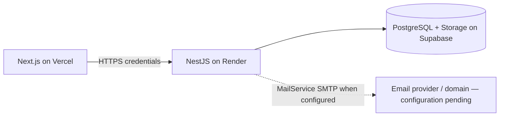

# Deployment & Environment Configuration Guide

Architecture: [ARCHITECTURE.md](./ARCHITECTURE.md). Auth: [AUTH_AND_ROLES_FLOW.md](./AUTH_AND_ROLES_FLOW.md).

---

## 1. Deployment topology



---

## 2. Environment variables

Use placeholders only in git. Real secrets belong in local `.env` (gitignored) or the host dashboard.

### Backend (`apps/candela-backend/.env`)

| Variable | Required | Description |
|---|---|---|
| `PORT` | Optional | Nest listen port (example `3001`) |
| `NODE_ENV` | Yes | `development` / `production` |
| `DATABASE_URL` | Yes | Postgres session pooler (runtime) |
| `DATABASE_URL_DIRECT` | Yes | Preferred for migrations (often same pooler) |
| `JWT_ACCESS_SECRET` | Yes | Access JWT signing secret |
| `JWT_REFRESH_SECRET` | Recommended | Refresh-related secret where used |
| `FRONTEND_URL` | Yes | Web origin for CORS and email links |
| `ADMIN_1_EMAIL` / `ADMIN_1_PASSWORD` / `ADMIN_1_NAME` | Seed | First admin; `ADMIN_2_*` optional |
| `ADMIN_SEED_OVERWRITE` | No | `true` only when rotating seeded passwords |
| `MAIL_TRANSPORT` | No | `log` (default in code if unset for skip) or `smtp`. `sendgrid` not wired |
| `SMTP_HOST` / `SMTP_PORT` / `SMTP_USER` / `SMTP_PASS` | If smtp | SMTP credentials |
| `SMTP_SECURE` | No | `true` for port 465 |
| `MAIL_FROM` | No | From header; defaults to `SMTP_USER` |
| `DOC_ID_REQUEST_TTL_HOURS` | No | Default 48 |
| `PASSWORD_RESET_TTL_HOURS` | No | Default 1 |
| `PATIENT_INVITATION_TTL_HOURS` | No | Default 72 |
| `ORG_INVITE_TTL_HOURS` | No | Default 72 |
| `GOOGLE_INVITATION_ACCEPT_TTL_MINUTES` | No | Default 15 |
| `GOOGLE_CLIENT_ID_WEB` | Google | Web OAuth client ID |
| `GOOGLE_CLIENT_ID_ANDROID` | Google | Android OAuth client ID |
| `SUPABASE_URL` | Storage | Project URL |
| `SUPABASE_SECRET_KEY` | Storage | Server-only secret |
| `SUPABASE_STORAGE_BUCKET` | Familiar Faces | Default `familiar-faces` |
| `SUPABASE_PROFILE_PHOTOS_BUCKET` | Profiles | Default `profile-photos` |

### Super Admin emergency access

Sensitive Super Admin HTTP requests must include header **`X-Emergency-Reason`** (non-empty; validated server-side). Rows are written to `emergency_audit_logs` (migration `AddEmergencyAuditLogs1800000000000`). That migration is required in each environment before relying on audited routes.

### Frontend (`apps/candela-app`)

| Variable | Required | Description |
|---|---|---|
| `NEXT_PUBLIC_API_URL` | Yes | Backend public URL |
| `NEXT_PUBLIC_GOOGLE_CLIENT_ID` | Google | Same as web Google client ID |

### Mobile (`apps/candela-mobile`)

| Variable | Required | Description |
|---|---|---|
| `EXPO_PUBLIC_API_URL` | Recommended | Backend URL; otherwise platform defaults / production URL in release builds |

---

## 3. Email delivery status

**Email delivery status: Implemented in application logic; external provider/domain configuration and live delivery testing pending.**

### What the application implements

- `MailService` supports `MAIL_TRANSPORT=log` (no send; returns `false`) and `MAIL_TRANSPORT=smtp` (nodemailer).
- `MAIL_TRANSPORT=sendgrid` is explicitly **not wired** (throws).
- Flows that call mail: patient invitations, doctor org invitations, DocID confirm/reject, password reset, emergency hospital-admin notices, related notifications.

### What is not claimed

- No production Candela email domain is documented as configured.
- Live invitation / reset / DocID delivery has **not** been marked verified in this documentation set.
- Local development can proceed with `MAIL_TRANSPORT=log` (links may be printed for debugging; tokens must not be logged in production paths).

### When a provider is chosen later

Set SMTP (or implement SendGrid), configure DNS/`MAIL_FROM`, then verify each invitation and reset journey end-to-end. Until then treat `emailSent: false` and resend as first-class recovery paths.

---

## 4. Database migrations

Pending migrations run on Nest process start (`main.ts` → `runPendingMigrations`).

Manual:

```bash
npm run migration:run -w @candela/backend
```

Relevant recent migrations include identity/memberships, patient organisation ownership, account activation / Google invite challenges, trial windows, and `emergency_audit_logs`.

Do not invent ownership for self-signup patients with `organization_id` null.

---

## 5. Supabase Storage

| Bucket env | Purpose | Required setup |
|---|---|---|
| `SUPABASE_STORAGE_BUCKET` | Familiar Faces photos | Private bucket |
| `SUPABASE_PROFILE_PHOTOS_BUCKET` | Patient/doctor photos, org logos | Private bucket |

Paths: `patients/`, `doctors/`, `organizations/` under the profile bucket. Clients receive signed URLs; they cannot set storage paths via profile PATCH.

**Live private-bucket upload/signed-URL QA:** treat as pending unless verified in the target environment.

---

## 6. Google OAuth

Configure Web and Android OAuth client IDs in Google Cloud Console and mirror them in backend/frontend env. Option C invitation acceptance requires live testing with a doctor-created invitee email.

**Live Google invite path QA:** pending unless verified.

---

## 7. Production notes

### Cookies across domains

`sameSite=none`, `secure=true`, `credentials: 'include'`, CORS allow-credentials with explicit origin.

### Admin seed

```bash
npm run seed:admins -w @candela/backend
```

---

## 8. Outstanding external / environment QA

| Item | Status in docs |
|---|---|
| Production email domain + provider | **Pending** |
| Live invitation / reset / DocID email delivery | **Pending** |
| Google OAuth Option C live path | **Pending** |
| Supabase profile-photos private bucket live upload | **Pending** |
| Mobile deep links for org / patient invitations | **Pending device QA** |
| Multi-connection Postgres trial concurrency | **Pending** (unit semantics covered in tests) |
| Web production build verification | **Pending** unless run in CI/environment |
| Emergency audit migration in each env | Apply / verify per environment |

Automated backend and shared unit tests, and TypeScript checks, are separate from the items above.

---

## 9. GitHub Actions & Slack

Production deploys on push to `main` (`.github/workflows/deploy.yml`).

| Secret | Purpose |
|---|---|
| `SLACK_WEBHOOK_URL_WEB` | Web/backend deploy notifications |
| `SLACK_WEBHOOK_URL_MOBILE` | EAS Android APK notifications |
| `VERCEL_TOKEN`, `VERCEL_ORG_ID`, `VERCEL_PROJECT_ID` | Vercel deploy |
| `RENDER_DEPLOY_HOOK_URL` | Render deploy hook |
| `EXPO_TOKEN` (+ backups) | EAS APK |

Never commit webhook URLs or tokens.
